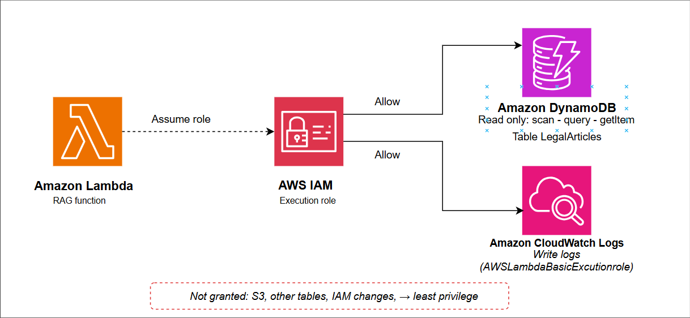
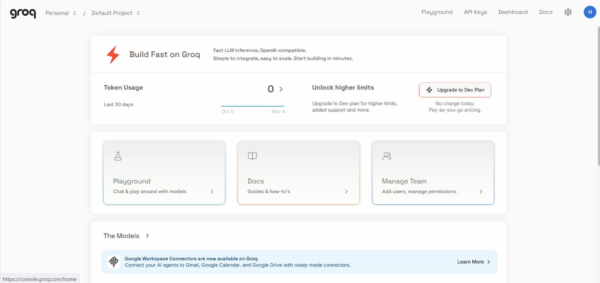
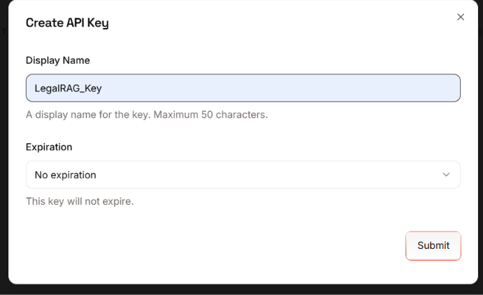
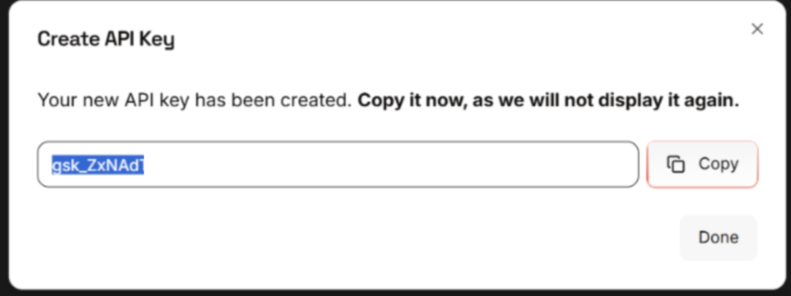
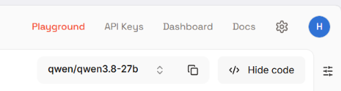
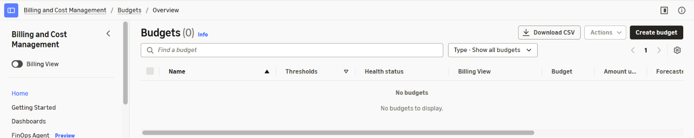
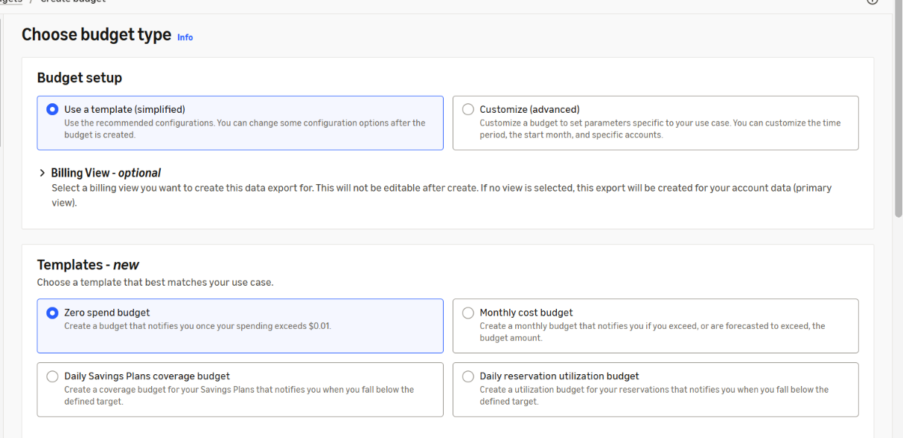
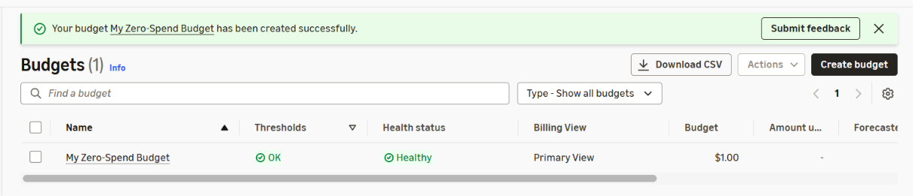

### AWS account and region
All resources are created in one region: **ap-southeast-2 (Asia Pacific, Sydney)**, matching the website URL. Enable MFA on the root account and work through an IAM user instead of the root user.

### IAM role for Lambda
Lambda needs only two permissions: reading the LegalArticles table and writing logs. Replace the placeholder with your own account ID and region.

```json
{
  "Version": "2012-10-17",
  "Statement": [
    {
      "Sid": "ReadLegalArticles",
      "Effect": "Allow",
      "Action": [
        "dynamodb:Scan",
        "dynamodb:Query",
        "dynamodb:GetItem"
      ],
      "Resource": "arn:aws:dynamodb:ap-southeast-2:<ACCOUNT_ID>:table/LegalArticles"
    },
    {
      "Sid": "CreateLogGroup",
      "Effect": "Allow",
      "Action": "logs:CreateLogGroup",
      "Resource": "arn:aws:logs:ap-southeast-2:<ACCOUNT_ID>:*"
    },
    {
      "Sid": "WriteLogs",
      "Effect": "Allow",
      "Action": [
        "logs:CreateLogStream",
        "logs:PutLogEvents"
      ],
      "Resource": "arn:aws:logs:ap-southeast-2:<ACCOUNT_ID>:log-group:/aws/lambda/legal-ai-chat-lambda:*"
    }
  ]
}
```

Also attach the managed policy **AWSLambdaBasicExecutionRole** so Lambda can write logs to CloudWatch.



### Groq account and API key
**Create an account and open the Groq Console**
1. Go to console.groq.com and sign in (or create a new account).
2. After signing in, you will see the Groq Console Dashboard.



The dashboard shows token usage for the last 30 days. The Playground, Docs, and Manage Team shortcuts let you test the model, read the documentation, and manage team members.

**Create an API key**
1. In the top-right menu, select **API Keys**.
2. On the API Keys page, the table shows "No keys" because no key exists yet. Select **Create API Key** on the right.
3. In the Create API Key dialog:
   - **Display Name:** give the key a recognizable name, up to 50 characters.
   - **Expiration:** choose how long the key is valid.
4. Select **Submit**.




The system displays the API key in the format `gsk_...`. Select **Copy** to copy it.

> **Note:** the key is shown only once. Save it somewhere secure immediately, because you cannot view it again after closing the window.



Select **Done** to finish.

**Select the model in Playground**
1. In the top menu, select **Playground**.
2. In the model selector at the top, choose the model you need. In this workshop, it is **qwen/qwen3.8-27b**.
3. Select **View code** (it shows "Hide code" when open) to see sample code that calls the API with the selected model.



### Resource inventory
| Resource | Name | Notes |
|---|---|---|
| S3 bucket | ai-legal-assistant-frontend-hau | Static website hosting |
| DynamoDB | LegalArticles | Knowledge base |
| Lambda | legal-ai-chat-lambda | Python |
| API Gateway | LegalChatAPI | Public endpoint for the website |

### Cost alerts
Create an AWS Budget with email alerts **before building anything**. The project goal is $0 within the Free Tier, and alerts help you catch anomalies early.

**Open Budgets**
1. In the AWS Management Console, type **Billing and Cost Management** in the search box and press Enter.
2. In the left menu, select **Budgets**.
3. Select **Create budget** on the right.



**Choose a budget type**
- **Budget setup:** select **Use a template (simplified)**, which uses the recommended preset configuration. The Customize (advanced) option allows more detailed settings but is not necessary here.
- **Template:** select **Zero spend budget**, which alerts you as soon as spending exceeds $0.01. Other templates such as Monthly cost budget, Savings Plans, or Reservation do not fit the $0 goal.
- **Billing View** is optional and can be skipped.
- Scroll to the bottom and select **Next**.



**Name the budget and set the alert email**
- **Budget name:** keep the default or choose a more recognizable name, for example LegalRAG-Zero-Spend.
- **Email recipients:** enter the email address for alerts. You can enter several addresses separated by commas (up to 10). The field shows "Enter a valid email address" while it is empty, so enter your real email.
- **Scope:** All AWS services, covering every service in the account.
- Keep the template settings at their defaults (you can change them later).
- Select **Create budget**.

*[Image placeholder: Budget name and alert email]*

**Result**
The budget is created and its status is **Healthy**. The Budget column shows $1.00, which is the template's baseline. The alert threshold remains $0.01.

*[Image placeholder: Budget created with Healthy status]*

### Legal reference
The reference source is Decree 13/2023/ND-CP. Before a demo, check whether the decree is still in force and whether any new law has amended or replaced part of it.
