### Overview
| Item | Details |
|---|---|
| Purpose | A serverless backend that retrieves legal provisions, calls the LLM, and exposes a stable API. |
| AWS services | DynamoDB, Lambda, API Gateway, CloudWatch |
| Input | HTTP POST containing the user's question |
| Output | Standard JSON with the answer or an error code |
| Dependencies | Prompt from Phase 1; Groq API key |

### 5.4.1 Build the knowledge base on DynamoDB
**Goal:** Store legal provisions in a table that Lambda can query.

**Create the LegalArticles DynamoDB table**
1. In the AWS Management Console, type **DynamoDB** in the search box and press Enter.
2. In the left menu, select **Tables**, then select **Create table**.

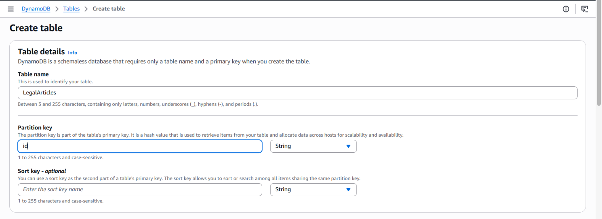

**Table details**
- **Table name:** LegalArticles. The name must be 3 to 255 characters and may contain only letters, numbers, underscores (_), hyphens (-), and periods (.).
- **Partition key:** id, type String. This is the primary key that identifies each provision. DynamoDB hashes this value to determine where to store and find the item.
- **Sort key (optional):** leave empty, because id is the only key the table needs.
- Keep the default settings and select **Create table**.

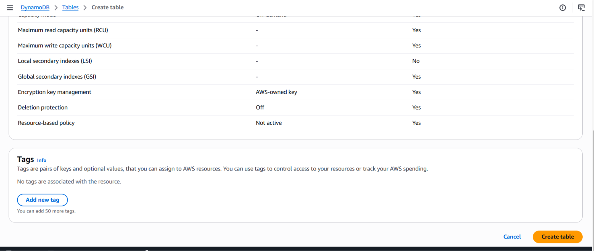

After a few seconds, the LegalArticles table becomes **Active**. The following steps add the provisions of Decree 13/2023/ND-CP to this table.

**Prepare the IAM role for Lambda**
1. In the AWS Management Console, type **IAM** in the search box and press Enter.

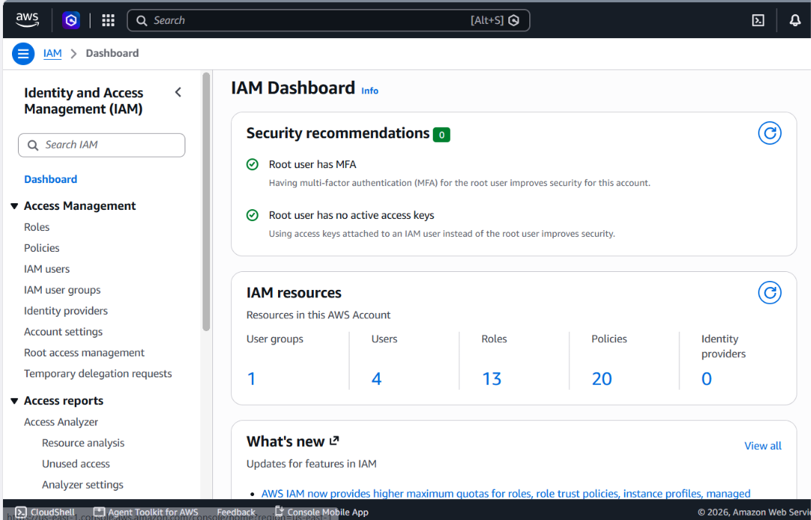

The **Security recommendations** section shows that the account meets two security recommendations: MFA is enabled on the root user, and the root user has no active access keys. This follows the correct practice: enable MFA on root and work through IAM users.

The **IAM resources** section summarizes existing resources. The left menu includes Roles, Policies, and IAM users. We will use **Roles** to create a role for Lambda.

1. In the left menu, select **Roles**. This page lists the account's roles. A role is an identity with specific permissions that uses short-term credentials and can be assumed by trusted entities such as Lambda.
2. Select **Create role** on the right.

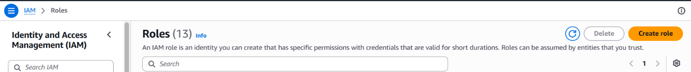

**Role settings**
- **Trusted entity type:** AWS service. **Use case:** Lambda.
- **Permissions:** attach the managed policy **AWSLambdaBasicExecutionRole** so Lambda can write logs to CloudWatch, and add a policy that allows reading the LegalArticles table (grant only the minimum permissions needed).
- **Role name:** a recognizable name, for example legal-ai-chat-role.
- Select **Create role**.

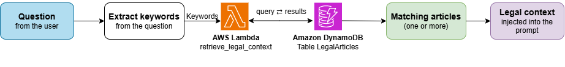

**Retrieving provisions from DynamoDB (retrieve_legal_context)**

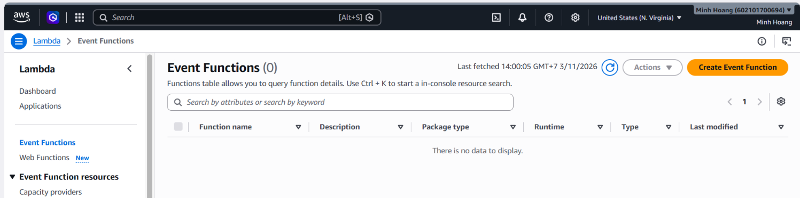

### 5.4.2 Write the AWS Lambda function (RAG logic and Groq API)
**Goal:** Retrieve legal context and generate the answer in a single Python function.

**Create the Lambda function**
1. In the AWS Management Console, type **Lambda** in the search box and press Enter.
2. The Functions page lists the Lambda functions in the current region. Select **Create function** on the right.
3. On the Create function page, select **Author from scratch**.

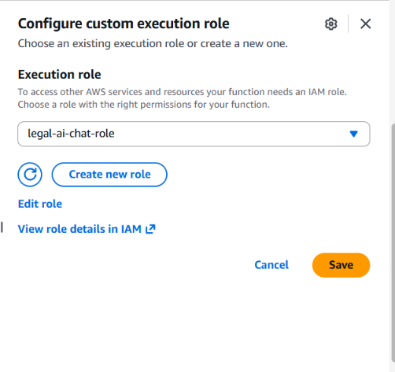
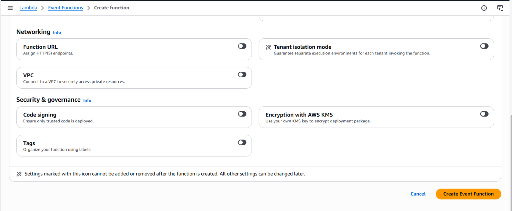

- **Function name:** legal-ai-chat-lambda. The name must be 1 to 64 characters, with no spaces, and may contain only letters, numbers, hyphens (-), and underscores (_).
- **Runtime:** **Python 3.12**.
- **Permissions:** by default, Lambda creates an execution role that can only write logs to CloudWatch Logs. Because this function also needs to read DynamoDB, we will use the role created in the previous step.

**Attach the role you created**
1. Scroll to **Additional settings** and turn on **Custom execution role**.
2. When enabled, the Configure custom execution role panel appears on the right. Open the **Execution role** list and select **legal-ai-chat-role**.
3. To review the role's permissions, select **View role details in IAM**.
4. Select **Save**.

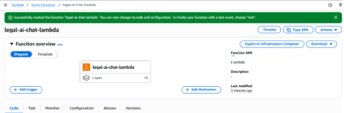
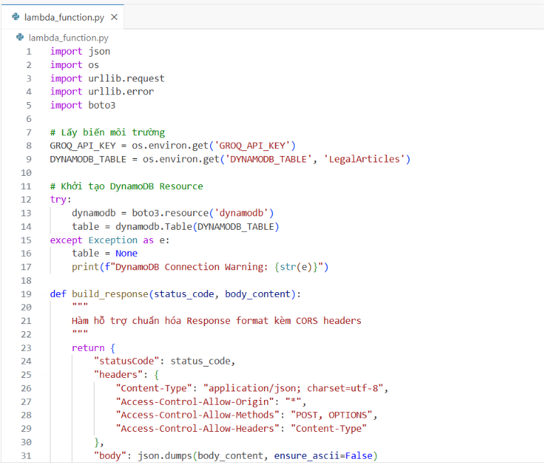

Keep the other options, such as ARM64 architecture, Function URL, VPC, and Durable execution, turned off. We will use API Gateway instead of a Function URL. Settings marked with their own icon cannot be added or removed after the function is created. The remaining settings can be changed later.

Select **Create function**. The message "Successfully created the function" appears.

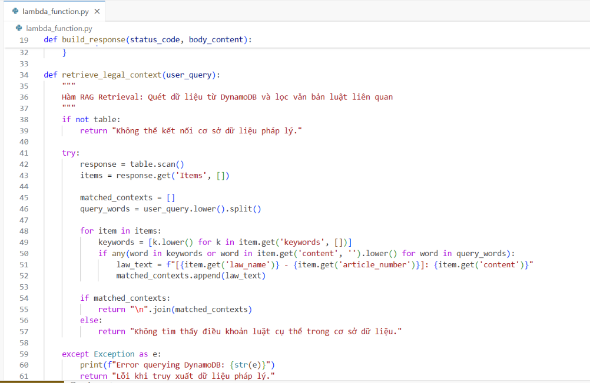

**Write the Lambda code (lambda_function.py)**

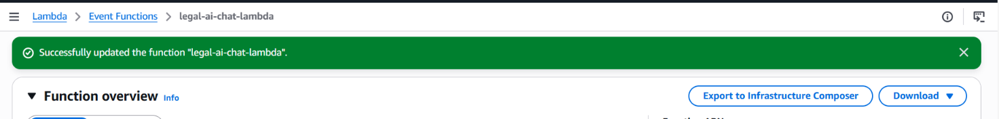

**Deploy the code to Lambda**
1. After pasting the code into lambda_function.py, select **Deploy** to save and apply it.
2. The green message "Successfully updated the function legal-ai-chat-lambda" confirms the code was updated. If you do not select Deploy, Lambda keeps running the old code.

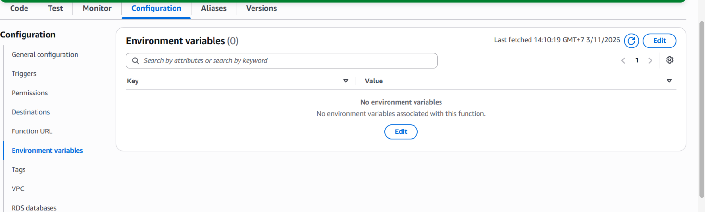


**Add the GROQ_API_KEY environment variable**
The code reads the key from the GROQ_API_KEY environment variable, so the key is not written directly in the code.
1. Select the **Configuration** tab, then select **Environment variables** in the left menu. The list is currently empty.
2. Select **Edit**, then select **Add environment variable** and enter:
   - **Key:** GROQ_API_KEY
   - **Value:** paste the API key (gsk_...) you copied from Groq.
3. Select **Save**. The system shows a success message.

The GROQ_API_KEY variable is now attached to the function. If this variable is missing, the function returns error 500, "Thiếu cấu hình GROQ_API_KEY trên hệ thống" (missing GROQ_API_KEY configuration), as written in the code.

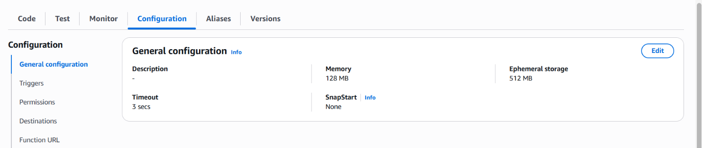

**Increase the function timeout**
1. On the Configuration tab, select **General configuration**, then select **Edit**.
2. By default, the function has 128 MB of memory, 512 MB of ephemeral storage, and a timeout of only 3 seconds.
3. Set **Timeout to 0 min 30 sec**. Three seconds is too short, because the function must query DynamoDB, call the Groq API, and wait for the model to generate the answer. If the function exceeds the timeout, Lambda stops it and the client receives an error.
4. Keep the execution role as legal-ai-chat-role, and keep Memory at 128 MB, which is sufficient for this workshop.
5. Scroll to the bottom and select **Save**.

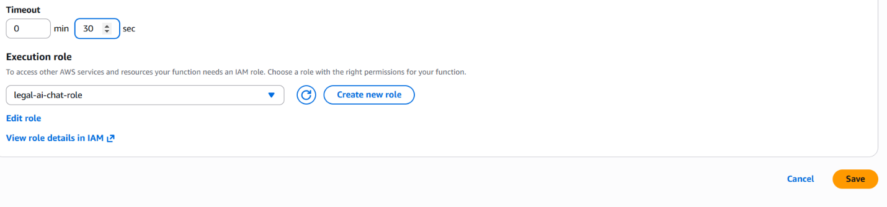

**Processing flow inside the Lambda function**

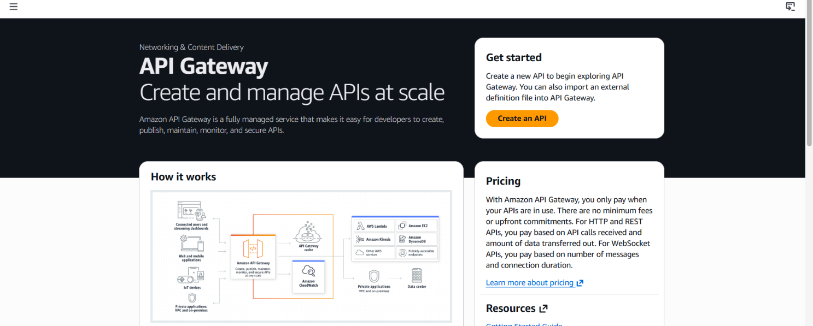

### 5.4.3 Configure API Gateway and standardize error handling
**Goal:** Expose the Lambda function through a public HTTPS endpoint that browsers are allowed to call.

**Steps**
1. Create an API (HTTP API) with a POST route that points to the Lambda function.
2. Configure CORS: Access-Control-Allow-Origin set to `*`, with the POST and OPTIONS methods.
3. Build an error-handling layer in Lambda that returns the codes listed below.
4. Deploy a stage and record the API call URL.

| Code | When it occurs | Meaning for the client |
|---|---|---|
| 400 | Invalid input | Correct the request |
| 429 | The Groq API limit is reached | Wait and retry |
| 502 / 504 | System or AI error | Retry later |

**Create an HTTP API**
1. In the AWS Management Console, type **API Gateway** in the search box and press Enter.

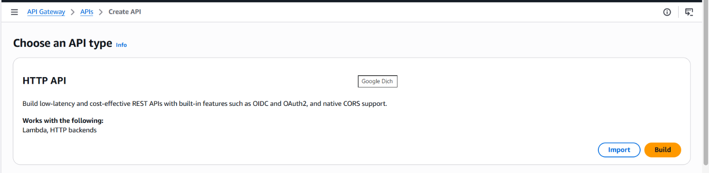

API Gateway is a fully managed service for creating, publishing, monitoring, and securing APIs at any scale. In this workshop, it serves as the public HTTPS gateway that lets the S3 website call the Lambda function.

2. Select **Create an API** in the Get started panel.
3. On the Choose an API type page, find the **HTTP API** card and select **Build**.

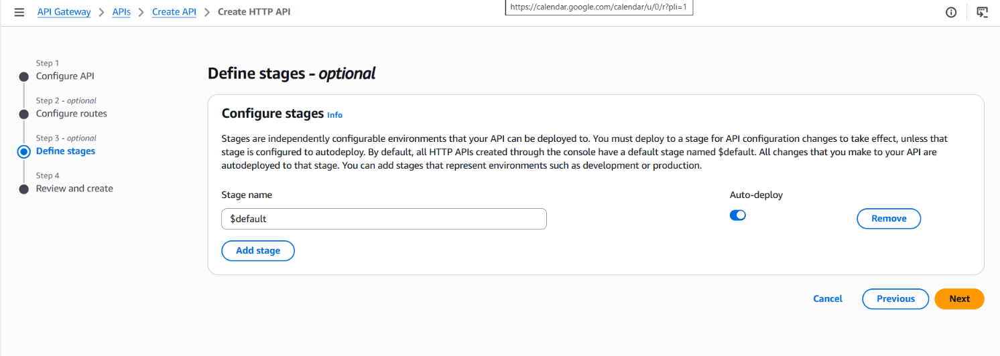

HTTP API offers low latency, low cost, built-in CORS support, and integration with Lambda. For this workshop, HTTP API is sufficient and cheaper than REST API.

**Step 1: Configure API**
- **API name:** LegalChatAPI.
- **IP address type:** keep IPv4.
- **Integrations:** select **Add integration**, then choose the **Lambda** integration type.
  - **AWS Region:** the region of the Lambda function.
  - **Lambda function:** legal-ai-chat-lambda.
  - **Version:** keep 2.0 (the payload format version for HTTP API).
- Select **Next**.

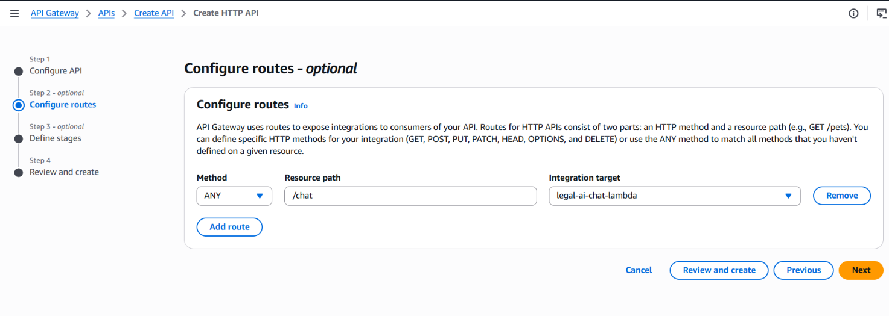
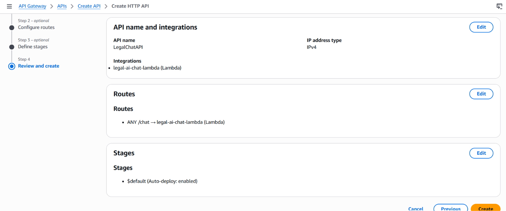

**Step 2: Configure routes**
A route consists of a method (HTTP verb) and a resource path.
- **Method:** POST
- **Resource path:** /chat
- **Integration target:** legal-ai-chat-lambda
- Select **Next**.

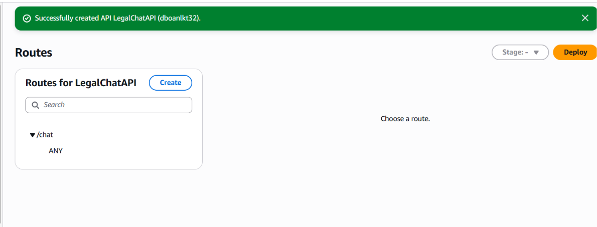

**Step 3: Define stages**
A stage is a deployment environment for the API, such as dev or prod. The console creates the default stage $default with **Auto-deploy** enabled, which means every change is deployed automatically. Keep the defaults and select **Next**.

**Step 4: Review and create**
Review the full configuration, then select **Create**.
- API name: LegalChatAPI, IPv4.
- Integrations: legal-ai-chat-lambda (Lambda).
- Routes: /chat → legal-ai-chat-lambda.
- Stages: $default (Auto-deploy: enabled).

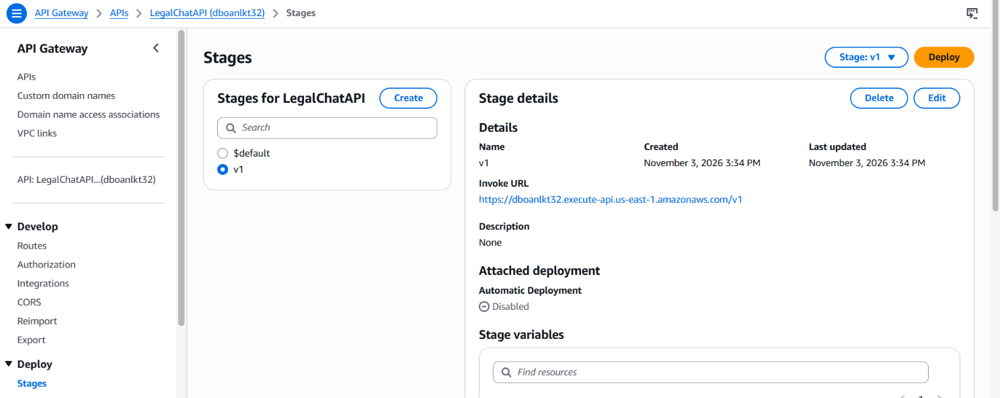

When the API is created, the message "Successfully created API LegalChatAPI" appears.

**Configure CORS**
CORS allows a web page on one domain (the S3 website) to call an API on another domain (API Gateway). Without this configuration, the browser blocks the request.
1. In the left menu, under **Develop**, select **CORS**. Initially, the fields show "No Origins/Headers/Methods are allowed," which means nothing is permitted yet.
2. Select **Configure** and enter:
   - **Access-Control-Allow-Origin:** enter `*`, then select **Add** (allows every origin).
   - **Access-Control-Allow-Headers:** enter `content-type`, then select **Add**.
   - **Access-Control-Allow-Methods:** select POST and OPTIONS.
   - **Access-Control-Max-Age:** keep 0. **Allow-Credentials:** keep NO.
3. Select **Save**.

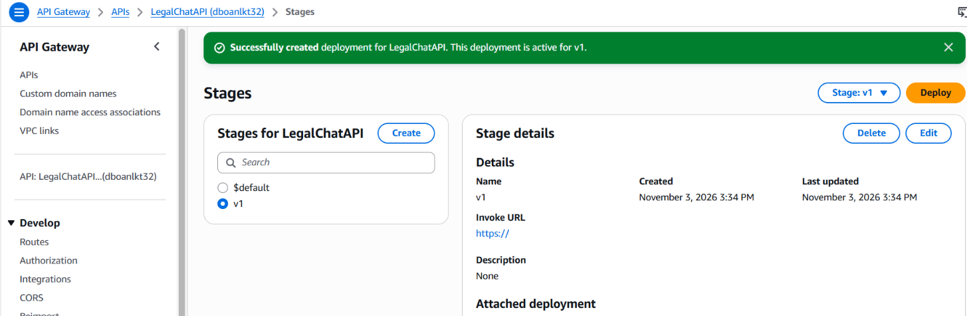

**Create the stage and deploy**
1. Select **Deploy**, then create a stage named **v1**.
2. The Stage details section shows the Invoke URL in the format `https://<api-id>.execute-api.<region>.amazonaws.com/v1`. This is the base address for calling the API.
3. Automatic Deployment for stage v1 is **Disabled**, so you must select Deploy manually after each configuration change.
4. Select **Deploy** and choose stage v1.

*[Image placeholder: Deploying stage v1]*

The message "Successfully created deployment for LegalChatAPI" confirms the API is live. The full URL for calling the function is:

`https://<api-id>.execute-api.<region>.amazonaws.com/v1/chat`

### 5.4.4 Test the backend
**Goal:** Confirm the backend works before connecting the interface.

**Steps**
1. Send a POST request with curl using a sample question:

```bash
curl -X POST "<API_URL>" \
  -H "Content-Type: application/json" \
  -d '{"question": "Can I use a citizen ID (CCCD) for buying and selling?"}'
```

2. Open CloudWatch Logs and check the response time, the returned data, and the JSON structure.
3. Test error cases: an empty question (400) and, if possible, a rate-limit case (429).

**Check:** curl returns a grounded answer, and the logs show the full processing flow.
