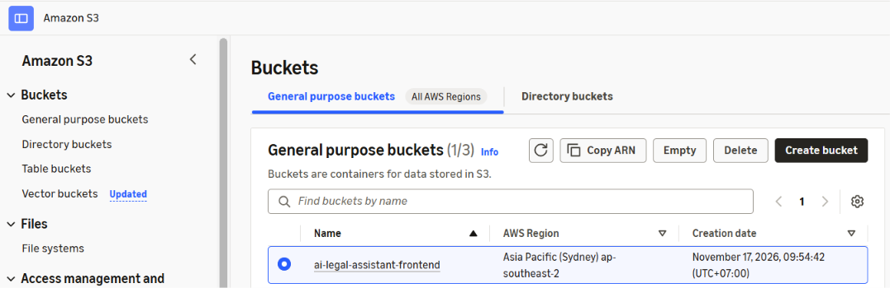
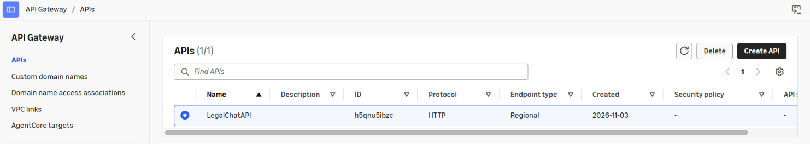
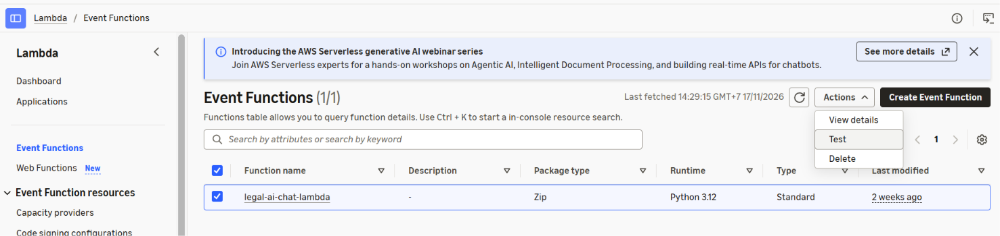
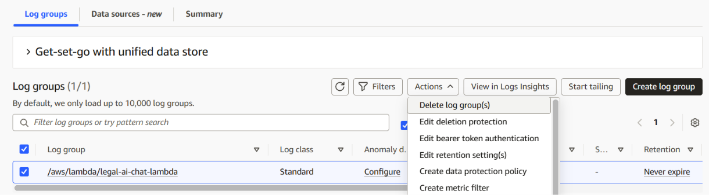
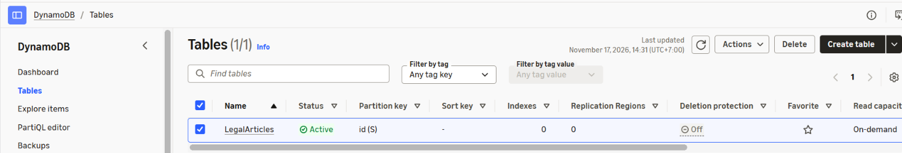
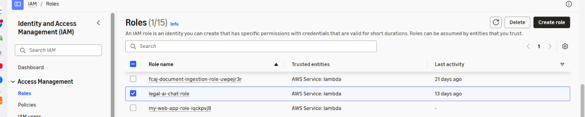
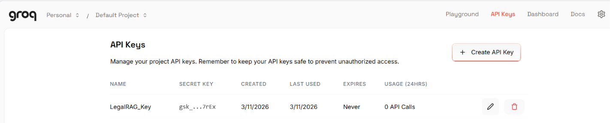

Delete the resources in the following order to avoid dependency errors and ongoing charges:

1. **S3 bucket** (delete the objects first, then the bucket).

2. **API in API Gateway** (LegalChatAPI).

3. **Lambda function** legal-ai-chat-lambda and its **CloudWatch log group**.

4. **DynamoDB table** LegalArticles.

5. **IAM role** legal-ai-chat-role created for Lambda.

6. **Revoke the Groq API key** in the Groq Console. Disable or delete the key created in section 5.2.

