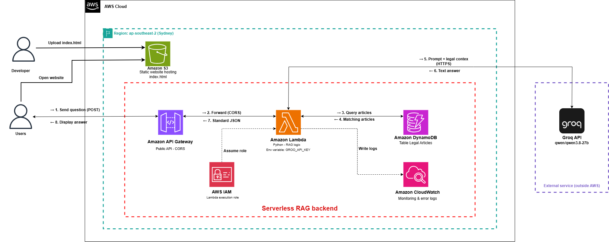

# AI Legal & Security Assistant
## Serverless RAG for Legal Research and Data Protection on AWS

Date: 2026-11-24

### Overview
AI Legal & Security Assistant is a preliminary legal advisory tool for businesses. It focuses on Decree 13/2023/ND-CP on personal data protection. Users enter a question or a real-world scenario. The system searches the relevant legal provisions in a database, and then a large language model analyzes the question based only on those provisions.

The system is not a lawyer and does not provide official legal conclusions. If the database lacks a legal basis, the system must state this clearly.

The system is built on a serverless architecture with the following components:
- **Interface:** a static web page (index.html) hosted on Amazon S3 with static website hosting.
- **API layer:** Amazon API Gateway (CORS and standardized error handling).
- **Backend:** AWS Lambda (Python), which retrieves legal provisions and calls the LLM.
- **Knowledge base:** Amazon DynamoDB (LegalArticles table).
- **LLM:** Groq API (qwen/qwen3.8-27b), an external service outside AWS.
- **Monitoring:** Amazon CloudWatch.

### Contents
- 5.1 Introduction
- 5.2 Prerequisites
- 5.3 Phase 1: Prompt design and RAG mechanism
- 5.4 Phase 2: Backend, from database to Lambda and API
- 5.5 Frontend: S3 static website
- 5.6 Security and operations
- 5.7 Final results and future development
- 5.8 Resource cleanup
